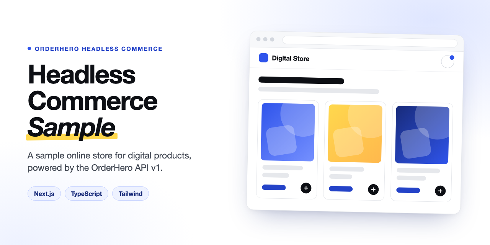

# OrderHero Headless Store (sample)



An online store for digital products with the **OrderHero Headless Commerce API v1** as its only backend.
Next.js App Router, TypeScript, Tailwind v4. No database, no webhooks.

## Getting started

```bash
cp .env.example .env.local   # set ORDERHERO_SECRET_KEY (ohsk_live_…)
npm install
npm run dev
```

Requires Node 20.9 or newer.

| Command | Purpose |
| --- | --- |
| `npm run dev` | development server |
| `npm run check` | lint + type check + tests (run before committing; CI runs the same) |
| `npm run build` | production build |

| Env | Required | Notes |
| --- | --- | --- |
| `ORDERHERO_SECRET_KEY` | yes | Secret key. The `catalog:read` + `checkout:write` scopes are enough. Server only. |
| `ORDERHERO_API_URL` | no | Defaults to `https://api.orderhero.id/v1`. Must be https. |
| `SITE_URL` | outside Vercel | Store address (https). Used for the status links in OrderHero's WhatsApp/email messages. |

> API v1 has no test mode: every order is a real order.

## Limitations of this sample

- **Digital** products only (no address or shipping).
- Pay-what-you-want products are sent to the OrderHero order form, because the API does not accept prices from the client.
- No captcha: spam protection relies on OrderHero's per-buyer limits. Add rate limiting at your hosting layer.
- Headless Commerce is still in beta and limited to the Enterprise plan.

## Changing the look and content

| To change | Open |
| --- | --- |
| Home page text, assurances, "How to buy" steps, polling interval | `config/site.ts` |
| Brand color, light/dark colors | `app/globals.css` (`--color-brand-*`, `:root`, `[data-theme='dark']`) |
| Fonts | `app/layout.tsx` (body) and `.font-display` in `app/globals.css` (headings) |
| Shape of buttons, cards, fields, choices | `components/ui/` |
| Order of the home page sections | `app/page.tsx` |
| Error messages shown to buyers | `lib/errors.ts` |

## Structure

```
app/                      routes (thin: fetch data, compose components)
  page.tsx                home page + catalog (cached for 300 seconds)
  products/[slug]/        product detail
  checkout/               page + server actions (quote, create order)
  orders/[ref]/           order status + server action (new payment code)
  api/orders/[ref]/       status route polled by the browser
components/
  ui/                     base components (Button, Card, Field, ChoiceList, …)
  layout/                 header, footer, theme, cart pill
  home/ catalog/ product/ checkout/ order/   one folder per feature
config/site.ts            store settings
lib/
  orderhero.ts            the ONLY file that calls the API (server-only)
  catalog.ts              API products → display data
  order-public.ts         the only gateway for order data to the browser (no buyer data)
  order-status.ts         paid / closed / expired rules
  cart.ts                 cart in localStorage (no prices)
  validation.ts           buyer validation (used by browser and server)
```

## Rules this code enforces

- The secret key is read only in `lib/orderhero.ts`; it never reaches the browser bundle.
- Prices are never calculated or sent from the browser; totals always come from `POST /checkout/quote`.
- Payment methods come from `GET /checkout/payment-methods`, with labels and order as returned.
- One checkout attempt = one `Idempotency-Key` + one `external_reference` (sessionStorage);
  when the outcome is uncertain, the order is read back, not created again.
- Payment codes (QRIS, VA, retail outlet) and manual transfer accounts are shown on `/orders/{ref}`; status is polled every 10 seconds.
- Proof of transfer is forwarded straight to OrderHero; this store does not keep any files.
- The status route only sends the fields in `lib/order-public.ts`; buyer data never reaches the browser.
- The store address for `status_url` comes from env/Vercel, not from request headers.

The API features in use can be checked at `GET /meta` → `data.features`.

## License

[MIT](LICENSE)
